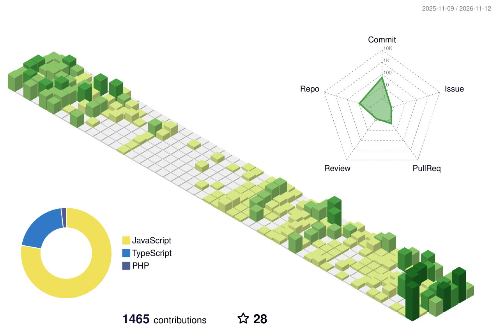

<!-- Header -->

  

  

  
  
  
  
  

---

## 👨‍💻 About Me

I'm a **Full Stack Engineer** with **3.5+ years of professional experience** (since June 2023), currently building production-grade applications at **[VendAxis FZ LLC](https://github.com/Vendaxis)**.

I build for **every screen**:

- 🌐 **Web**: React and Next.js frontends on Node.js and Laravel APIs
- 📱 **Mobile**: cross-platform iOS and Android apps with React Native and Expo
- 🖥️ **Desktop**: Windows, macOS and Linux apps with Electron

I also maintain **open-source starter templates** for each of these stacks, so every new project starts production-ready: auth, security headers, testing, Docker and CI included.

 

---

## 🛠️ Tech Stack

#### 💻 Languages
<table>
  <tr>
    <td align="center" width="96"> <b>TypeScript</b></td>
    <td align="center" width="96"> <b>JavaScript</b></td>
    <td align="center" width="96"> <b>PHP</b></td>
    <td align="center" width="96"> <b>Python</b></td>
    <td align="center" width="96"> <b>HTML5</b></td>
    <td align="center" width="96"> <b>CSS3</b></td>
  </tr>
</table>

#### 🎨 Frontend
<table>
  <tr>
    <td align="center" width="96"> <b>React</b></td>
    <td align="center" width="96"> <b>Next.js</b></td>
    <td align="center" width="96"> <b>Vite</b></td>
    <td align="center" width="96"> <b>Tailwind CSS</b></td>
    <td align="center" width="96"> <b>shadcn/ui</b></td>
  </tr>
  <tr>
    <td align="center" width="96"> <b>Redux</b></td>
    <td align="center" width="96"> <b>TanStack Query</b></td>
    <td align="center" width="96"> <b>React Hook Form</b></td>
    <td align="center" width="96"> <b>Material UI</b></td>
    <td align="center" width="96"> <b>Framer Motion</b></td>
  </tr>
</table>

#### 📱 Mobile
<table>
  <tr>
    <td align="center" width="96"> <b>React Native</b></td>
    <td align="center" width="96"> <b>Expo</b></td>
    <td align="center" width="96"> <b>Android</b></td>
    <td align="center" width="96"> <b>iOS</b></td>
  </tr>
</table>

#### 🖥️ Desktop
<table>
  <tr>
    <td align="center" width="96"> <b>Electron</b></td>
    <td align="center" width="96"> <b>Windows</b></td>
    <td align="center" width="96"> <b>macOS</b></td>
    <td align="center" width="96"> <b>Linux</b></td>
  </tr>
</table>

#### ⚙️ Backend & APIs
<table>
  <tr>
    <td align="center" width="96"> <b>Node.js</b></td>
    <td align="center" width="96"> <b>Express</b></td>
    <td align="center" width="96"> <b>Laravel</b></td>
    <td align="center" width="96"> <b>Inertia.js</b></td>
    <td align="center" width="96"> <b>Livewire</b></td>
  </tr>
  <tr>
    <td align="center" width="96"> <b>REST API</b></td>
    <td align="center" width="96"> <b>GraphQL</b></td>
    <td align="center" width="96"> <b>Swagger / OpenAPI</b></td>
    <td align="center" width="96"> <b>JWT</b></td>
    <td align="center" width="96"> <b>Zod</b></td>
  </tr>
</table>

#### 🗄️ Databases
<table>
  <tr>
    <td align="center" width="96"> <b>MySQL</b></td>
    <td align="center" width="96"> <b>PostgreSQL</b></td>
    <td align="center" width="96"> <b>MongoDB</b></td>
    <td align="center" width="96"> <b>SQLite</b></td>
    <td align="center" width="96"> <b>Firebase</b></td>
  </tr>
</table>

#### 🧪 Testing
<table>
  <tr>
    <td align="center" width="96"> <b>Vitest</b></td>
    <td align="center" width="96"> <b>Jest</b></td>
    <td align="center" width="96"> <b>Playwright</b></td>
    <td align="center" width="96"> <b>Testing Library</b></td>
  </tr>
</table>

#### 🧰 DevOps & Tools
<table>
  <tr>
    <td align="center" width="96"> <b>Docker</b></td>
    <td align="center" width="96"> <b>GitHub Actions</b></td>
    <td align="center" width="96"> <b>Git</b></td>
    <td align="center" width="96"> <b>GitHub</b></td>
  </tr>
  <tr>
    <td align="center" width="96"> <b>Vercel</b></td>
    <td align="center" width="96"> <b>Postman</b></td>
    <td align="center" width="96"> <b>Figma</b></td>
    <td align="center" width="96"> <b>VS Code</b></td>
  </tr>
</table>

---

## 📊 GitHub Stats

  

  

  

---

## 🧊 Contribution Graph

  <picture>
    <source media="(prefers-color-scheme: dark)" srcset="./profile-3d-contrib/profile-night-rainbow.svg" />
    <source media="(prefers-color-scheme: light)" srcset="./profile-3d-contrib/profile-green-animate.svg" />
    
  </picture>

  <picture>
    <source media="(prefers-color-scheme: dark)" srcset="https://raw.githubusercontent.com/masabqurban/masabqurban/output/growing-snake-dark.svg" />
    <source media="(prefers-color-scheme: light)" srcset="https://raw.githubusercontent.com/masabqurban/masabqurban/output/growing-snake.svg" />
    
  </picture>

<!-- Footer -->

  

